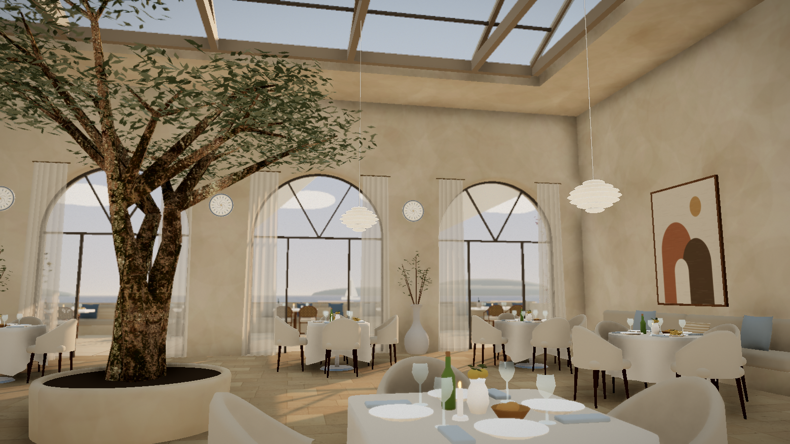
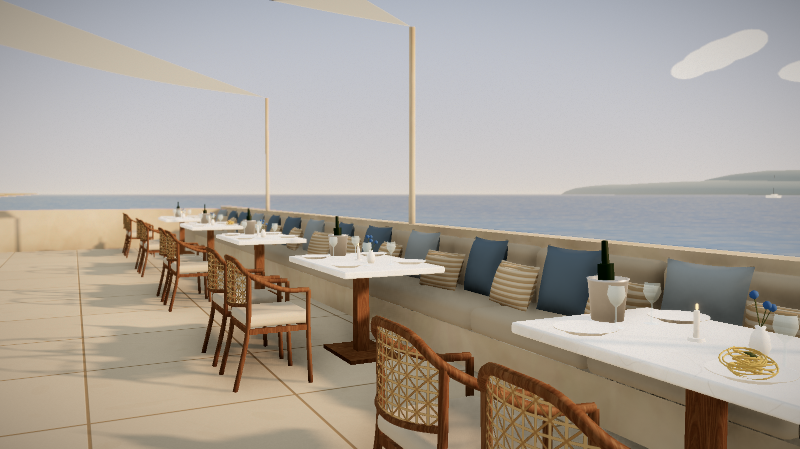
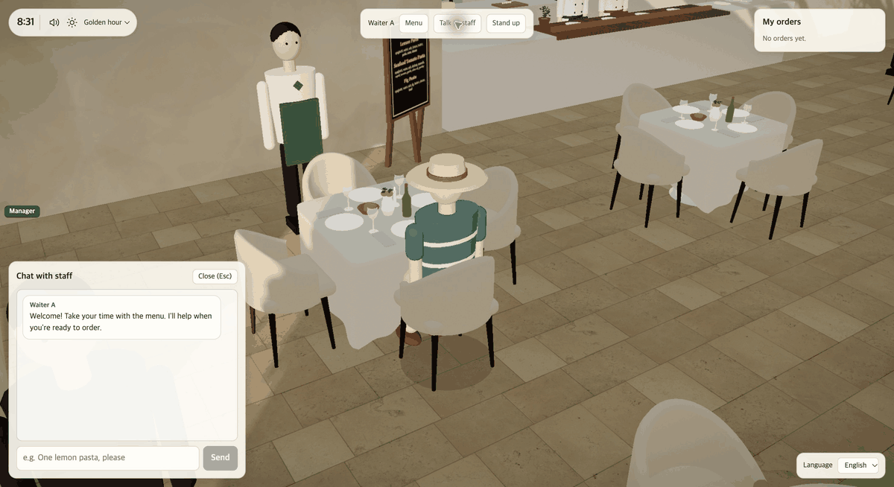
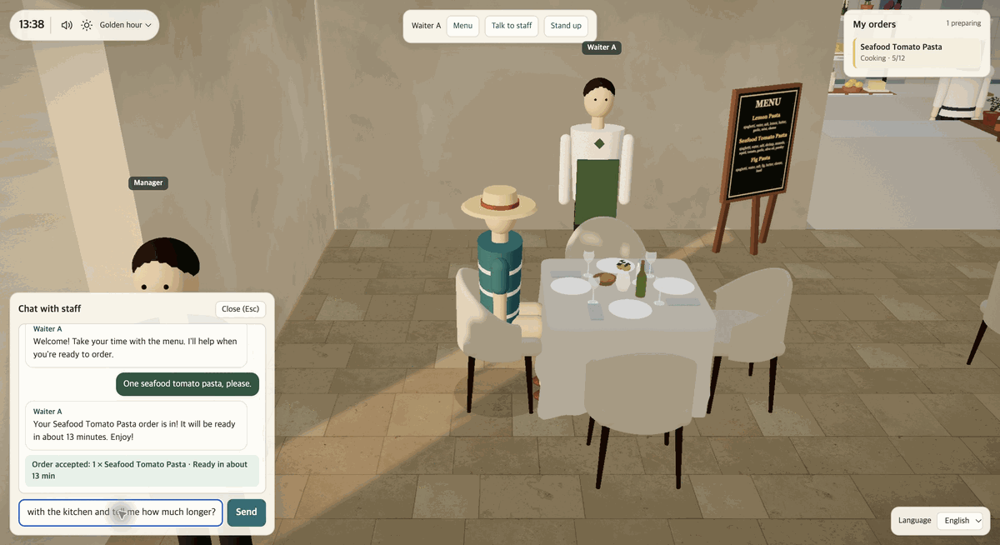
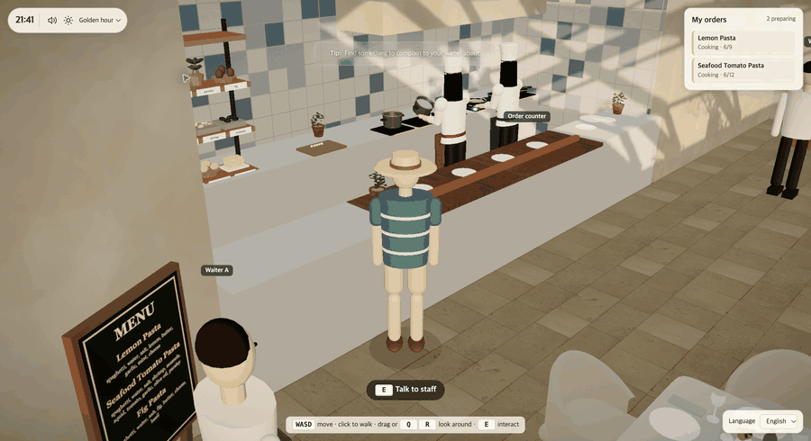
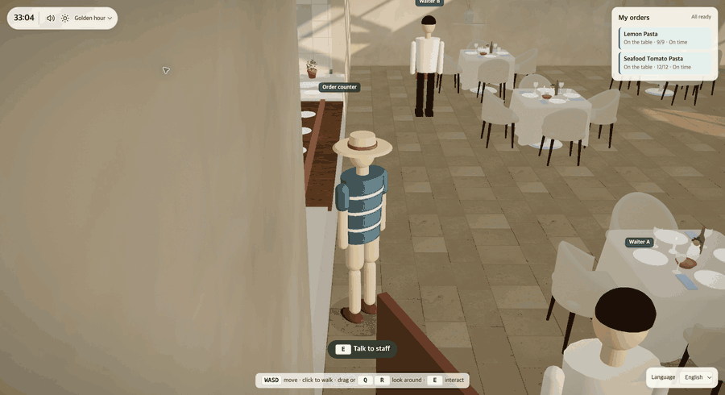
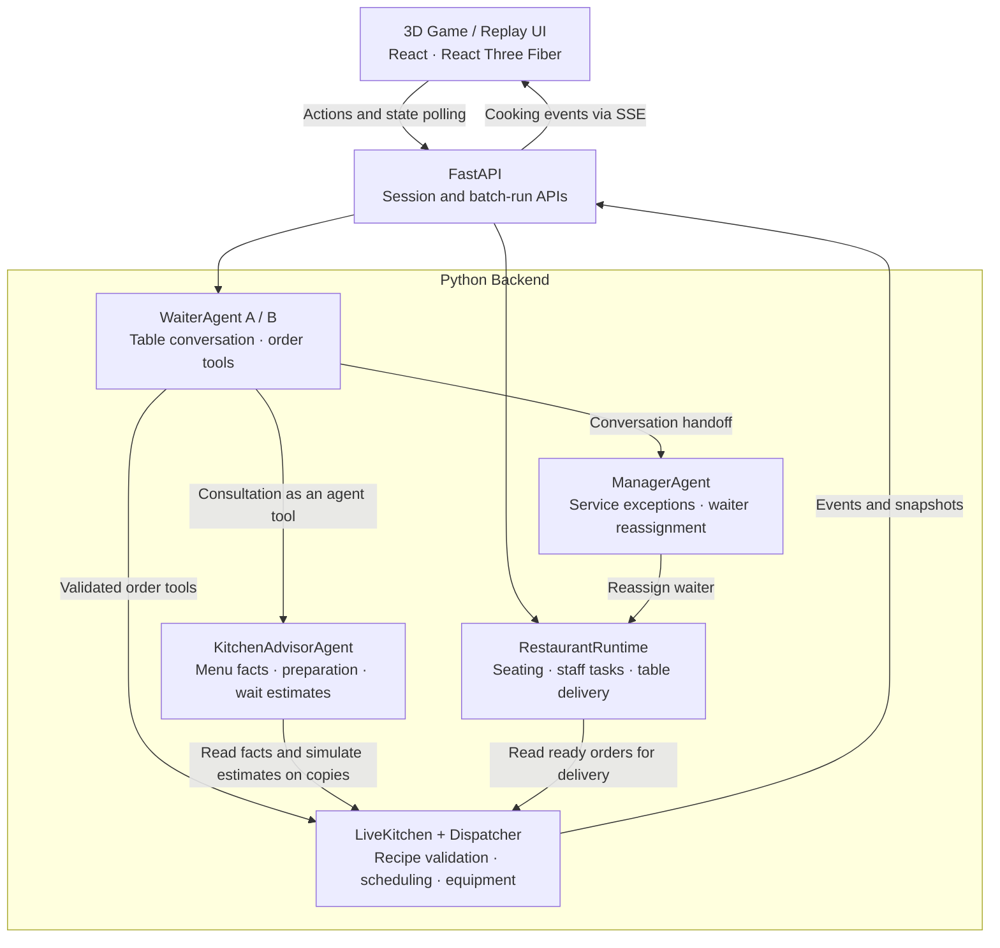

# Restaurant Agent Team

**A playable 3D beach restaurant with conversational AI staff and a kitchen simulation.**
<p>
  <a href="docs/images/scene-dining.png"></a>
  <a href="docs/images/scene-terrace.png"></a>
</p>

Explore the dining room, take a seat, and order pasta by talking to your waiter. Watch chefs prepare your meal, ask about ingredients or recommendations, and have your food brought to the table.

The project connects natural-language interaction to a working restaurant simulation: AI staff handle conversation and invoke validated tools, while Python code owns cooking, equipment allocation, seating, and delivery state.

**Demo** · Click a GIF to enlarge.

<table>
<tr>
<td width="50%"><a href="docs/images/staff-complaint-gameplay.gif"></a><br>Complaints → manager handoff and a new waiter.</td>
<td width="50%"><a href="docs/images/kitchen-check-gameplay.gif"></a><br>“Why so long?” → “I'll check with the kitchen.”</td>
</tr>
<tr>
<td><a href="docs/images/live-cooking-gameplay.gif"></a><br>Live cooking and order progress.</td>
<td><a href="docs/images/restaurant-terrace-gameplay.gif"></a><br>Dining room and seaside terrace.</td>
</tr>
</table>

## Architecture



## Core Design Choices

### Stateful waiters & read-only kitchen advice

Waiters retain table-scoped conversation history and place orders through validated tools. For recommendations or progress questions, they consult `KitchenAdvisorAgent`, which reads menu and order data and estimates waits on copies of the live kitchen. The waiter keeps the conversation; cooking continues independently.
### Resource-constrained cooking

Recipes are directed acyclic graphs of tasks. The simulator enforces dependencies and exclusive equipment ownership; the `Dispatcher` ranks feasible tasks with:

```text
score = -deadline - 0.001 × remaining_work + 0.00001 × background
```

Higher scores run first, favoring earlier deadlines and less remaining work. Duration estimates adapt through an exponential moving average (EMA) of completed tasks' timing deviations. See [scheduling details](docs/priority-scheduling.md).

### Ownership

`RestaurantRuntime` owns seating, staff assignments, and delivery. Complaints trigger a handoff to `ManagerAgent`, which inspects service state and can reassign a waiter through validated tools. Agents interpret intent; runtime code enforces every state change.


## Tech Stack

| Layer | Technologies | Role |
| --- | --- | --- |
| Frontend | TypeScript, React, Vite | Game interface, conversation panels, and replay controls |
| 3D rendering | Three.js, React Three Fiber, Drei, React Three Postprocessing | Restaurant scene, characters, cooking effects, and lighting |
| UI state | React hooks, Zustand | Player interaction, scene settings, and client presentation state |
| Backend | Python 3.12+, FastAPI, Pydantic, Uvicorn | Validated HTTP endpoints, live sessions, and event streaming |
| AI staff | OpenAI Agents SDK, OpenAI models | Waiter conversations, kitchen consultation tools, and manager handoffs |
| Simulation | Python recipe/task models and priority dispatcher | Task dependencies, equipment ownership, simulated time, and deadlines |
| Development and verification | uv, npm, Python unittest, Node.js test runner, TypeScript | Dependency management, offline checks, and builds |

## Local Setup

Requires **Python 3.12+**, **uv**, **Node.js 22.18+**, and an **OpenAI API key**.

1. Install dependencies from the repository root:

   ```bash
   uv sync --project backend --extra agent --extra api --locked
   npm --prefix frontend ci
   ```

2. Add your key and model to the root `.env` file:

   ```dotenv
   OPENAI_API_KEY=your_api_key_here
   RESTAURANT_MODEL=gpt-4o
   ```

3. Run the backend and frontend in separate terminals:

   ```bash
   # Terminal 1
   backend/.venv/bin/uvicorn pasta_chef.main:app --app-dir backend/src --reload
   ```

   ```bash
   # Terminal 2
   npm --prefix frontend run dev
   ```

Open **http://localhost:5173** (or the URL printed by Vite).
